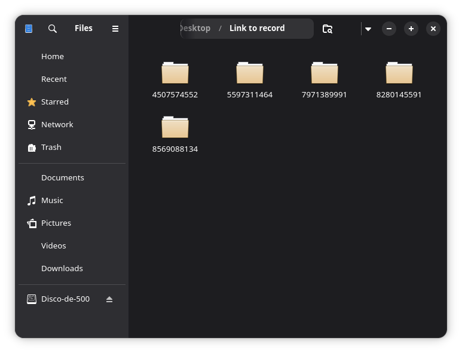
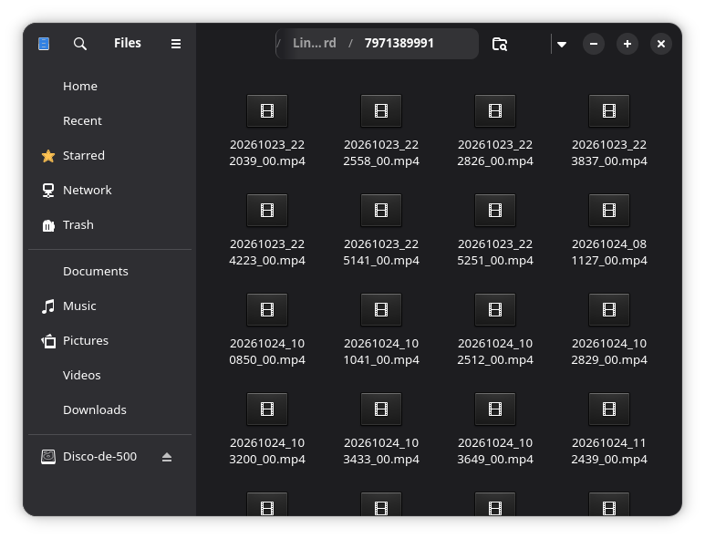
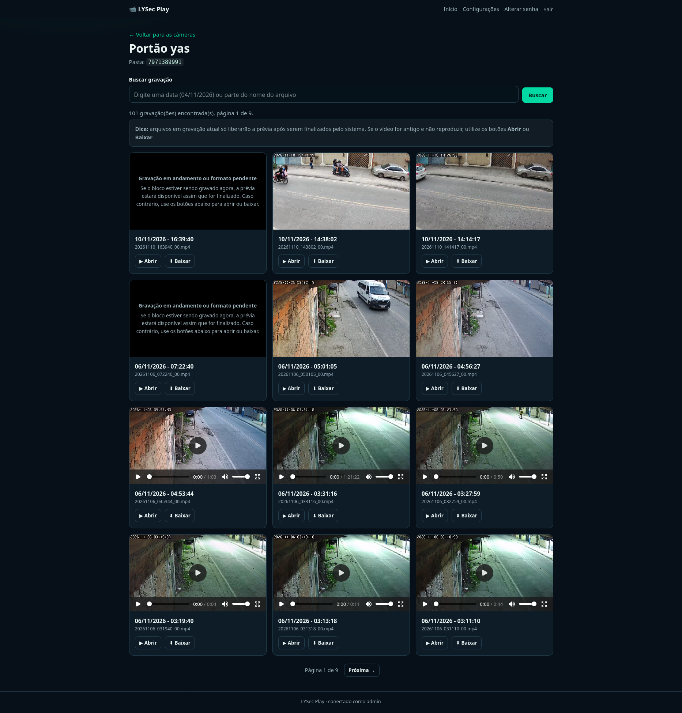
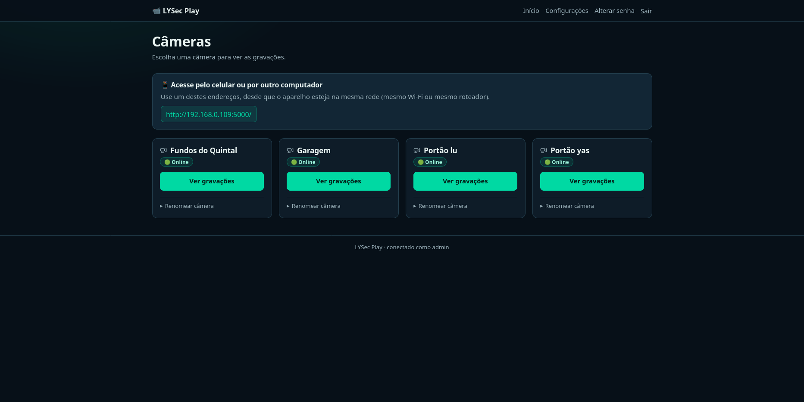

# [ LEO_SEC_OPS ] // Central de Monitoramento de Câmeras

> Sistema web leve desenvolvido em **Python (Flask)** para centralizar, visualizar e gerenciar gravações de câmeras de segurança do sistema **Yoosee** de forma limpa, rápida e intuitiva.

---

## O Problema que este Projeto Resolve

As câmeras que utilizam o ecossistema **Yoosee** armazenam as gravações brutas no diretório do sistema separadas por pastas com sequências gigantescas de números aleatórios. Dentro delas, os ficheiros de vídeo seguem nomenclaturas complexas baseadas em timestamps crus (`YYYYMMDD_HHMMSS_00.mp4`).




Para uma pessoa comum, encontrar um vídeo específico ou saber a qual câmera e horário ele pertence exigia abrir os ficheiros um por um. 

O **[ LEO_SEC_OPS ]** nasce exatamente para solucionar isso:
* **Abas Amigáveis (Aliases):** Mapeia os códigos complexos de pastas das câmeras para nomes fáceis de identificar (ex: *Fundos do Quintal*, *Portão da Garagem*, etc.).
* **Conversão Inteligente de Timestamps:** Transforma nomes crípticos de ficheiros em datas e horários legíveis (`DD/MM/YYYY - HH:MM:SS`).
* **Player Integrado com Suporte a Range Request:** Permite reproduzir os vídeos direto no navegador de forma fluida, sem precisar fazer o download prévio de ficheiros pesados.
* **Rotina de Purge Automática:** Remove gravações conforme os dias de retenção configurados no painel, prevenindo que o disco rígido fique lotado.

---

## Visual do Sistema

### Painel Principal (Dashboard de Nós)


### Central de Feed e Reprodução de Gravações


---

## Funcionalidades Principais

* **Interface Cyberpunk / Terminal:** Painel com design futurista de alto contraste, otimizado para leitura rápida e visual moderno.
* **Login com Sessão:** Tela de acesso restrito com senha protegida por hash, CSRF, expiração de sessão e limite de tentativas.
* **Busca por Data/Hora:** Filtre as gravações da câmera ativa pela barra de pesquisa.
* **Paginação Otimizada:** Exibição dividida em lotes (12 vídeos por página) para garantir leveza e velocidade na navegação.
* **Customização Dinâmica de Nomes:** Altere os apelidos visuais das câmeras de forma simples através de modais interativos, mantendo intacta a estrutura original das pastas no servidor.
* **Configuração Persistente:** Caminho das gravações e dias de retenção ficam em `config.json`, sem banco de dados.
* **Proteções Operacionais:** Validação de caminhos, escrita atômica do JSON, lock entre processos, limite de payload, CSRF e limpeza resiliente a falhas de permissão.

---

## Tecnologias Utilizadas

* **Backend:** Python 3, Flask (Framework web minimalista e veloz) e Waitress (servidor de produção)
* **Frontend:** HTML5, Bootstrap 5, CSS Customizado com estética Cyberpunk / Terminal (`Share Tech Mono`)
* **Gerenciamento de Arquivos:** Manipulação nativa do sistema de ficheiros em Windows/Linux (`os`, `pathlib`, `re`, `datetime`, `math`)
* **Distribuição:** PyInstaller (executável único e portátil, sem exigir Python no computador do cliente)

---

## ⚙️ Como Executar o Projeto Localmente

1. Tenha o **Python 3.10+** instalado (Windows ou Linux).
2. Clone o repositório:
   ```bash
   git clone https://github.com/Leonardo-12953/central_cameras.git
   cd central_cameras
   ```
3. Crie o ambiente virtual e instale as dependências.

   Linux/macOS:
   ```bash
   python3 -m venv venv
   source venv/bin/activate
   pip install -r requirements.txt
   ```

   Windows (PowerShell):
   ```powershell
   python -m venv venv
   .\venv\Scripts\Activate.ps1
   pip install -r requirements.txt
   ```
4. Execute:
   ```bash
   python app.py
   ```
5. Acesse `http://127.0.0.1:5000` e configure o diretório das gravações em **⚙ CONFIGURAÇÕES**.

O servidor usa **Waitress** por padrão. O servidor de desenvolvimento do Flask só é usado com `FLASK_DEBUG=1`.

Por padrão o servidor escuta apenas em `127.0.0.1`. Para expor na rede, configure o login abaixo e, de preferência, use HTTPS por meio de um proxy reverso.

### Login de acesso

Para exigir usuário e senha, defina `APP_USERNAME` junto de `APP_PASSWORD_HASH` (recomendado) ou `APP_PASSWORD` (texto puro). O jeito mais simples é criar um arquivo `.env` na raiz do projeto, que é carregado automaticamente e já está no `.gitignore`:

```bash
python app.py hash-password
```

Copie o hash gerado e crie o `.env`:

```env
APP_USERNAME=admin
APP_PASSWORD_HASH='scrypt:32768:8:1$...'
```

Depois inicie normalmente:

```bash
python app.py
```

Reinicie o processo depois de alterar o `.env`. Você será redirecionado para a tela de login; a sessão fica válida por `AUTH_SESSION_LIFETIME_MINUTES` e há limite de tentativas por IP.

> Se `APP_USERNAME` e uma senha/hash não forem definidos, o sistema continua aberto, sem tela de login. Use isso somente em ambiente local.

### Variáveis de ambiente

| Variável | Padrão | Descrição |
|---|---|---|
| `HOST` | `127.0.0.1` | Endereço de escuta (`0.0.0.0` para a rede local). |
| `PORT` | `5000` | Porta inicial; se estiver ocupada, a próxima livre é usada. |
| `OPEN_BROWSER` | `1` no executável, `0` no código-fonte | Abre o navegador automaticamente. |
| `FLASK_DEBUG` | `0` | Use `1` somente em desenvolvimento. |
| `SERVER_THREADS` | `8` | Threads do servidor Waitress. |
| `CAMERAS_CONFIG` | `config.json` ao lado do executável/app.py | Caminho absoluto ou relativo do JSON de configuração. |
| `SECRET_KEY` | arquivo `.secret_key` gerado | Chave de sessão/CSRF. |
| `APP_USERNAME` | vazio | Usuário da tela de login. |
| `APP_PASSWORD_HASH` | vazio | Hash da senha gerado por `python app.py hash-password` (recomendado). |
| `APP_PASSWORD` | vazio | Senha em texto puro; use apenas para testes locais. |
| `AUTH_SESSION_LIFETIME_MINUTES` | `720` | Duração da sessão autenticada, em minutos. |
| `LOGIN_MAX_ATTEMPTS` | `5` | Tentativas de login permitidas por IP dentro da janela. |
| `LOGIN_ATTEMPT_WINDOW_SECONDS` | `300` | Janela de contagem/bloqueio das tentativas de login. |
| `SESSION_COOKIE_SECURE` | `0` | Use `1` quando acessar por HTTPS. |
| `TRUSTED_HOSTS` | vazio | Lista separada por vírgula de hosts aceitos (ex.: `camera.local,127.0.0.1`). |
| `MAX_CONTENT_LENGTH` | `1048576` | Tamanho máximo de requisição em bytes. |
| `CLEANUP_INTERVAL_SECONDS` | `3600` | Intervalo do agendador interno de limpeza. |
| `ACTIVE_FILE_GRACE_SECONDS` | `600` | Arquivos modificados recentemente não são apagados. |
| `DISABLE_CLEANUP_SCHEDULER` | `0` | Use `1` para desativar o agendador interno. |
| `LOG_LEVEL` | `INFO` | Nível de log (`DEBUG`, `INFO`, `WARNING`, `ERROR`). |
| `LOG_TO_FILE` | `1` | Grava `central_cameras.log` com rotação automática. |
| `LOG_FILE` | `central_cameras.log` na pasta de dados | Caminho alternativo do arquivo de log. |

As variáveis também podem ser definidas em um arquivo `.env` na raiz do projeto (ou ao lado do executável), no formato `CHAVE=valor`. O modelo está em `.env.example`.

### 📦 Gerar executável para clientes

O cliente final **não precisa instalar Python, Git nem dependências**. O build gera um executável único para cada sistema:

- Windows: `dist/CentralCameras-windows.zip`
- Linux: `dist/CentralCameras-linux.zip`

Cada pacote inclui o executável, `LEIA-ME.txt`, `.env.example` e `config.example.json`.

**No Windows**, execute:

```bat
build_windows.bat
```

**No Linux**, execute:

```bash
chmod +x build_linux.sh
./build_linux.sh
```

Os scripts criam uma venv isolada em `.build-venv`, instalam PyInstaller e montam o `.zip`. O PyInstaller **não faz compilação cruzada**: para gerar o `.exe` é necessário rodar no Windows, e o binário Linux no Linux.

**Pelo GitHub Actions** (recomendado para ter os dois):

1. Envie o projeto para um repositório no GitHub.
2. Abra **Actions → Gerar executáveis → Run workflow**.
3. Baixe os artefatos `CentralCameras-windows` e `CentralCameras-linux`.
4. Para publicar uma release automática, crie uma tag:
   ```bash
   git tag v1.0.0
   git push origin v1.0.0
   ```

O executável é portátil: `config.json`, `.env` e `.secret_key` ficam na mesma pasta. Se essa pasta não permitir gravação (por exemplo, `C:\Program Files`), o programa usa automaticamente `%APPDATA%\CentralCameras` no Windows ou `~/.local/share/central_cameras` no Linux, e mostra o caminho no log.

> O executável não é assinado digitalmente. No Windows pode aparecer o SmartScreen; o cliente deve clicar em **Mais informações → Executar assim mesmo**. O guia do cliente está em `LEIA-ME.txt`.

### Limpeza de gravações

O processo principal inicia um agendador interno de limpeza. Para ambientes WSGI externos (gunicorn, uwsgi, etc.), onde o `main` não é executado, rode a limpeza por cron ou systemd timer:

```bash
python app.py purge
```

A limpeza:
- valida o caminho configurado e recusa raízes perigosas como `/`, `/home`, `/mnt`, `/etc` e similares;
- percorre subdiretórios sem seguir symlinks;
- remove apenas arquivos `.mp4` regulares;
- ignora arquivos modificados nos últimos `ACTIVE_FILE_GRACE_SECONDS`;
- usa travamento de arquivo para evitar duas limpezas simultâneas;
- registra quantos arquivos removeu, erros e itens ignorados.

### Segurança e operação

- O `debug` fica desligado por padrão; habilite apenas localmente com `FLASK_DEBUG=1`.
- Para uso em rede, configure `APP_USERNAME` e `APP_PASSWORD_HASH`; prefira HTTPS e `SESSION_COOKIE_SECURE=1`.
- A tela de login usa sessão assinada, CSRF, comparação em tempo constante e limite de tentativas por IP.
- Proteja o `.env` com `chmod 600 .env`; ele guarda o hash da senha (ou a senha, se usar `APP_PASSWORD`).
- O arquivo `.secret_key`, locks, backups e temporários são gerados em runtime e não devem ser versionados.
- O `config.json` é escrito de forma atômica e possui backup `.bak`.
- Permissões: o usuário do processo precisa de leitura/execução no diretório das gravações e escrita nos diretórios para que a retenção funcione. Prefira um usuário dedicado, com o mínimo de privilégios.
