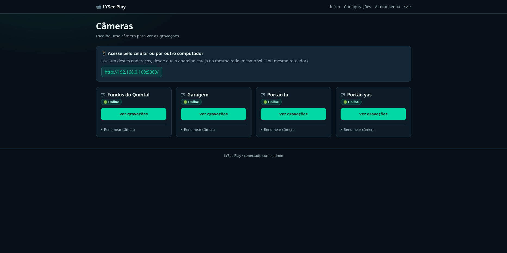
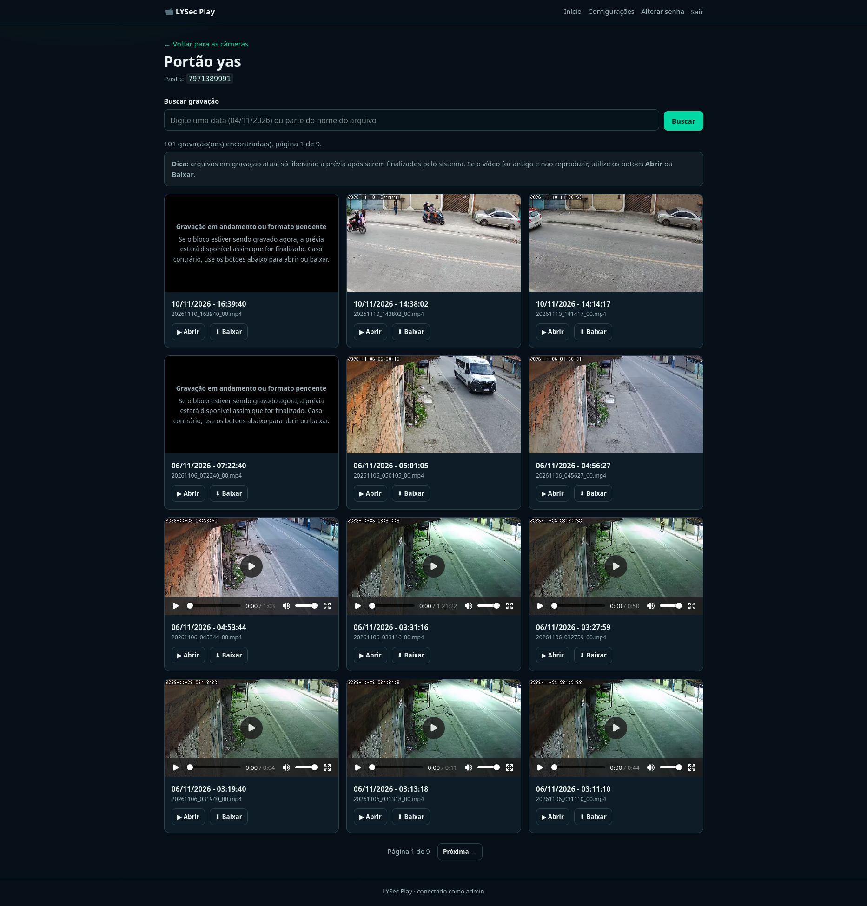

# 📹 LYSec Play

Central de câmeras Yoosee no navegador: organiza as gravações que o Yoosee
Desktop salva no computador e transforma aqueles nomes incompreensíveis em
câmeras, datas e horários legíveis.

## Por que existe

Eu tinha 4 câmeras Yoosee e nenhum cartão de memória. A solução foi instalar o
Yoosee Desktop no Windows e gravar direto no HD da máquina — o armazenamento
estava resolvido, mas achar as gravações virou um problema.

O Yoosee salvava tudo em pastas e arquivos com IDs numéricos enormes, e esses
nomes não podiam ser alterados sem risco de quebrar o funcionamento do programa.
Na prática, encontrar o vídeo de um horário específico era garimpar no escuro.

Foi daí que surgiu o LYSec Play: ele lê a estrutura original do Yoosee sem
mexer em nada e traduz os IDs para nomes de câmera e para data/hora de verdade.
O Yoosee continua funcionando normalmente; quem ganha uma interface simples é
você.

## O que ele faz

- Dá nomes fáceis às câmeras (“Portão”, “Garagem”…) sem renomear as pastas
  originais.
- Converte os nomes dos arquivos em data e hora legíveis.
- Permite assistir, abrir e baixar as gravações pelo navegador.
- Busca gravações por data ou por parte do nome do arquivo.
- Apaga automaticamente as gravações mais antigas que o prazo configurado.
- Exige login e pode ser acessado pelo celular ou por outro computador da mesma
  rede.

> O programa **não grava** as câmeras. Ele organiza e exibe as gravações que o
> Yoosee Desktop já salva no computador.





## Como rodar

Baixe o pacote mais recente na página de
[Releases](https://github.com/Leonardo-12953/central_camera_yoosee/releases).
Não é preciso instalar Python nem usar o terminal.

**Windows:** extraia o `.zip` e dê dois cliques em `CentralCameras.exe`.

**Linux:**

```bash
chmod +x CentralCameras
./CentralCameras
```

O navegador abre sozinho. No primeiro acesso, crie o usuário e a senha e informe
a pasta onde o Yoosee salva as gravações. Pronto.

Passo a passo completo, com senha, arquivos e problemas comuns:
[COMO_USAR.md](COMO_USAR.md).

## Acessar pelo celular ou outro computador

O programa já fica disponível na rede local. Use o endereço mostrado na tela
inicial — algo como `http://192.168.0.10:5000/` — em um aparelho conectado à
mesma rede. Se não abrir, libere a porta `5000` no firewall.

## Visualização ao vivo (LYSec Play | Live Viewer)

O painel inclui a aba **Ao vivo**, servida pelo Live Viewer (RTSP → HLS), que
agora faz parte desta mesma pasta em `live_viewer/`. Basta iniciar o Central:
ele sobe o viewer automaticamente em `http://127.0.0.1:8088` e o encerra junto
com o Central.

- A pasta `live_viewer/` está dentro do Central, então o sistema inteiro é
  apenas **uma pasta**. O projeto antigo `yoosee_viewer/` pode ficar onde está
  como referência/backup; o Central não o usa mais.
- Pela interface do viewer dá para **adicionar câmeras** e **alterar o nome**
  delas, sem editar arquivos.
- Se o viewer já estiver em execução, o Central apenas se conecta a ele e não
  interfere no processo existente.
- Para usar um viewer em outra máquina, desmarque o início automático e ajuste
  a URL do serviço nas configurações.
- O log do processo iniciado pelo Central fica em
  `live_viewer/logs/central_sidecar.log`.

**Para distribuir:** envie a pasta `central_cameras/` inteira, mas **remova
`live_viewer/secrets.json` antes** — as senhas ficam lá em texto puro (permissão
`600`) e não devem acompanhar o pacote. No computador de destino, crie
`live_viewer/secrets.json` com as chaves usadas em `live_viewer/config.json`.
Os segmentos HLS em `live_viewer/streams/` e os logs são gerados em execução e
não precisam ser enviados.

> No modo executável empacotado, o início automático ainda depende de um Python
> disponível no sistema. A integração completa no executável está prevista como
> etapa seguinte.

## Rodar a partir do código

```bash
python3 -m venv venv
source venv/bin/activate        # Windows: .\venv\Scripts\Activate.ps1
pip install -r requirements.txt
python app.py
```

Acesse `http://127.0.0.1:5000`. O servidor usa **Waitress** por padrão; para
desenvolvimento com recarga automática, use `FLASK_DEBUG=1`.

Para gerar os executáveis:

```bat
build_windows.bat
```

```bash
./build_linux.sh
```

Os pacotes saem em `dist/`. Opções avançadas de rede, sessão e limpeza estão
documentadas no [.env.example](.env.example).
