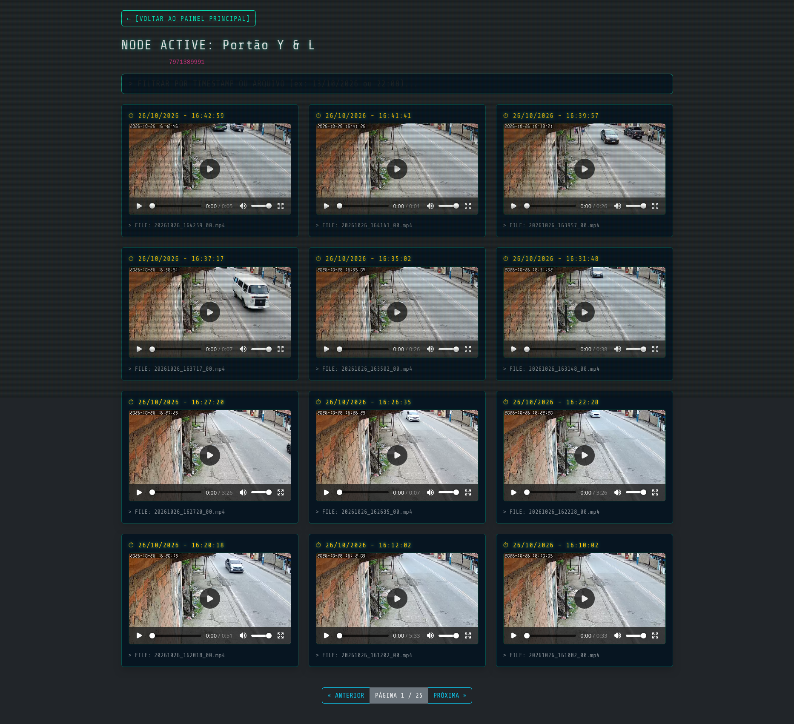
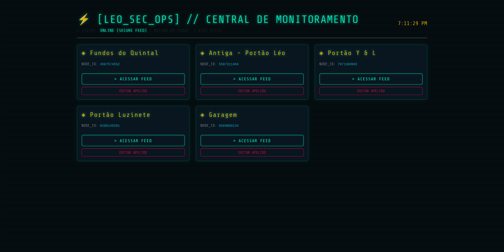

# [ LEO_SEC_OPS ] // Central de Monitoramento de Câmeras

> Sistema web leve desenvolvido em **Python (Flask)** para centralizar, visualizar e gerenciar gravações de câmeras de segurança do sistema **Yoosee** de forma limpa, rápida e intuitiva.

---

## O Problema que este Projeto Resolve

As câmeras que utilizam o ecossistema **Yoosee** armazenam as gravações brutas no diretório do sistema separadas por pastas com sequências gigantescas de números aleatórios. Dentro delas, os ficheiros de vídeo seguem nomenclaturas complexas baseadas em timestamps crus (`YYYYMMDD_HHMMSS_00.mp4`).


Para uma pessoa comum, encontrar um vídeo específico ou saber a qual câmera e horário ele pertence exigia abrir os ficheiros um por um. 

O **[ LEO_SEC_OPS ]** nasce exatamente para solucionar isso:
* **Abas Amigáveis (Aliases):** Mapeia os códigos complexos de pastas das câmeras para nomes fáceis de identificar (ex: *Fundos do Quintal*, *Portão da Garrente*, etc.).
* **Conversão Inteligente de Timestamps:** Transforma nomes crípticos de ficheiros em datas e horários legíveis (`DD/MM/YYYY - HH:MM:SS`).
* **Player Integrado com Suporte a Range Request:** Permite reproduzir os vídeos direto no navegador de forma fluida, sem precisar fazer o download prévio de ficheiros pesados.
* **Rotina de Purge Automática:** Um "faxineiro automático" embutido que remove gravações com mais de **5 dias**, prevenindo que o disco rígido (HD) fique soterrado de dados e lotado[cite: 11].

---

## Visual do Sistema

### Painel Principal (Dashboard de Nós)


### Central de Feed e Reprodução de Gravações


---

## Funcionalidades Principais

* **Interface Cyberpunk / Terminal:** Painel com design futurista de alto contraste, otimizado para leitura rápida e visual moderno.
* **Busca em Tempo Real:** Filtre instantaneamente as gravações da câmera ativa digitando a data ou horário desejado diretamente na barra de pesquisa.
* **Paginação Otimizada:** Exibição dividida em lotes (12 vídeos por página) para garantir leveza e velocidade na navegação.
* **Customização Dinâmica de Nomes:** Altere os apelidos visuais das câmeras de forma simples através de modais interativos integrados, mantendo intacta a estrutura original das pastas no servidor.

---

## Tecnologias Utilizadas

* **Backend:** Python 3, Flask (Framework web minimalista e veloz)
* **Frontend:** HTML5, Bootstrap 5, CSS Customizado com estética Cyberpunk / Terminal (`Share Tech Mono`)
* **Gerenciamento de Arquivos:** Manipulação nativa do sistema de ficheiros do Linux (`os`, `re`, `datetime`, `math`)

---

## ⚙️ Como Executar o Projeto Localmente

1. Certifica-te de ter o **Python 3** instalado na tua máquina/servidor Linux.
2. Clona este repositório:
   ```bash
   git clone [https://github.com/Leonardo-12953/central_cameras.git](https://github.com/Leonardo-12953/central_cameras.git)
   cd central_cameras
